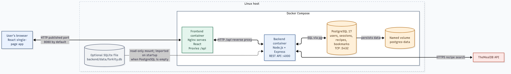

# Forkity

Forkity is a recipe hub for discovering recipes online, saving personal recipes, and viewing recipe details. This repository contains the application and its local Docker Compose setup. CI/CD and cloud deployment infrastructure belong to the separate deployment repository.

## Stack

- **Frontend:** React and Vite with custom CSS; no Bootstrap or UI framework
- **Backend:** Node.js and Express REST API
- **Database:** PostgreSQL
- **Online recipe search:** TheMealDB, requested by the backend

## Architecture

The browser loads the React frontend from the Nginx frontend container. Nginx proxies `/api` requests to the Express backend container. The backend searches TheMealDB and stores accounts, sessions, recipes, and bookmarks in the PostgreSQL database container.



The editable Mermaid source is in [docs/architecture.mmd](docs/architecture.mmd), with request-flow notes in [docs/architecture.md](docs/architecture.md).

## Run with Docker

Requirements: Docker Engine with Linux containers and Docker Compose v2.

For automatic setup on Ubuntu/Debian or Rocky Linux, run the matching script from the project root:

```sh
./linux_scripts/ubuntu_script.sh
```

```sh
./linux_scripts/rocky_script.sh
```

The scripts install Docker when needed, prepare `.env`, build the containers, and start the application. Open `http://localhost:8080` (or the port set by `FORKITY_PORT` in `.env`). For manual setup steps, see [LINUX_COMMANDS.md](LINUX_COMMANDS.md).

Create the local environment file, then replace its example database password with a strong random value:

```powershell
Copy-Item .env.example .env
```

Start all three containers from the project root:

```bash
docker compose up --build
```

Open `http://localhost:8080` (or the port set by `FORKITY_PORT` in `.env`). The frontend, backend, and database run as separate Linux containers. PostgreSQL is available only on the internal Compose network.

PostgreSQL data is stored in the named `postgres-data` volume and survives container restarts and `docker compose down`.

## Run on Minikube

This deploys the frontend, backend, and PostgreSQL as separate Kubernetes workloads in the `app` namespace. It does not use Docker Compose. You need Minikube, `kubectl`, and a container runtime. The commands below use Minikube's Docker driver; Docker must be running, and your Linux user must be allowed to access its socket.

On Ubuntu, verify Docker access with `docker info`. If the `docker` group was just added to your account, sign out and back in (or start a refreshed shell with `newgrp docker`) before continuing. Membership in the `docker` group grants root-equivalent privileges.

Start Minikube:

```bash
minikube start --driver=docker
```

From the project root, build both application images directly into Minikube's image store:

```bash
minikube image build -t forkity-backend:local -f backend/Dockerfile .
minikube image build -t forkity-frontend:local -f frontend/Dockerfile .
```

Create the namespace and a database Secret. This generates a random password without putting its value in the command history:

```bash
kubectl create namespace app --dry-run=client -o yaml | kubectl apply -f -
DB_PASSWORD="$(openssl rand -hex 32)"
kubectl create secret generic forkity-db -n app \
  --from-literal=POSTGRES_DB=forkity \
  --from-literal=POSTGRES_USER=forkity \
  --from-literal=POSTGRES_PASSWORD="$DB_PASSWORD"
unset DB_PASSWORD
```

Apply the workloads and wait for all three pods to become ready:

```bash
kubectl apply -f k8s/forkity.yaml
kubectl get pods -n app -w
```

In another terminal, forward the frontend service to port 8080 on your Ubuntu machine:

```bash
kubectl port-forward -n app service/frontend 8080:80
```

Open <http://localhost:8080>. Leave the port-forward command running while using the app.

The frontend sends `/api` requests through its Nginx proxy to the Kubernetes `backend` Service. The backend reaches PostgreSQL at the `db` Service on port 5432. The database uses a persistent volume claim, so stopping or restarting Minikube does not remove its data. `NODE_ENV=development` is set in this local-only manifest so the app's session cookie works over the HTTP port-forward; use HTTPS and production cookie settings for an internet-facing deployment.

This starts with a new PostgreSQL database; it does not import an existing `backend/data/forkity.db` file.

To inspect startup problems, use `kubectl get pods -n app`, `kubectl describe pod -n app <pod-name>`, and `kubectl logs -n app deploy/backend`. Stop Minikube with `minikube stop`. Deleting the `app` namespace also deletes the database workload and its persistent volume claim; back up data before doing so.

### Local development

For hot reload outside the containers, install Node.js 22 or newer and npm, create `.env` as described above, start the database container with `docker compose up -d db`, then run:

```bash
npm install
npm run dev
```

The Vite frontend runs at `http://localhost:5173` and proxies API calls to the local backend on port 4000.

### Existing local data

On first startup, if the PostgreSQL volume is empty and `backend/data/forkity.db` exists, the backend imports its users, recipes, and bookmarks into PostgreSQL. Sign in with your existing account afterward. Sessions are not imported, so existing users need to sign in again. The import is skipped once PostgreSQL contains Forkity data.

## Features

- Search online recipes through TheMealDB
- Open recipe details, including ingredients and instructions
- Register and sign in with a personal account
- Add, browse, and view recipes stored per account in PostgreSQL
- Bookmark recipes to your account; your added recipes and bookmarks appear together in **My recipes**
- Responsive layout styled with project-owned CSS

## Project layout

```text
frontend/       React app, custom styles, Nginx config, and image build
backend/        Express API, PostgreSQL access, SQLite importer, and image build
linux_scripts/  Automated Docker setup and launch scripts for Ubuntu and Rocky Linux
compose.yaml    Three-service Linux container stack
docs/           Architecture diagram and its source
```

Codex AI chat public link: https://chatgpt.com/s/cx_6ab994b7fe64819196de84e9b54aad67